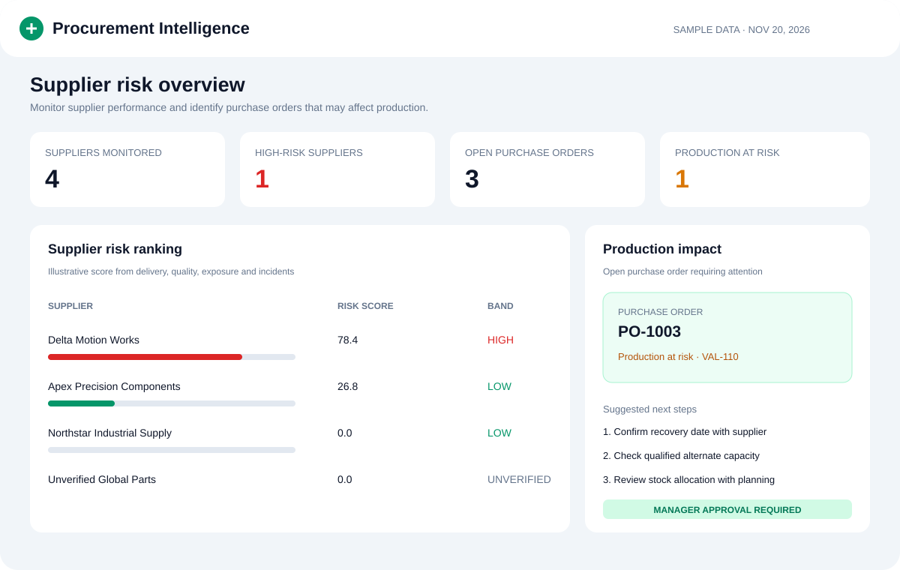
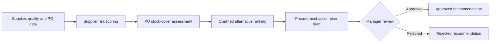

# AI Procurement & Supplier Risk Agent

An explainable procurement decision-support API for manufacturers. It reviews supplier delivery and quality history, scores supplier risk, identifies purchase orders that could interrupt production, compares qualified alternative suppliers, and prepares action plans for manager review.

> **Demo scope:** Synthetic data and deterministic scoring rules. This is a runnable decision-support prototype—not a trained ML model, live ERP integration, or autonomous purchasing system.

## Dashboard preview



*Illustrative dashboard concept based on the API's sample data. This repository currently provides a REST API and Swagger UI, not a browser dashboard.*

## Business scenario

A manufacturer depends on suppliers for production-critical components. One supplier begins missing delivery dates and quality checks while open purchase orders approach the dates the factory needs those parts. Procurement needs to identify risk early, assess stock cover, compare qualified alternatives, and prepare actions for manager review.

This demo helps answer:
- Which suppliers show the highest delivery and quality risk?
- Which open purchase orders could run out of stock before replenishment?
- Are qualified alternatives available with sufficient capacity?
- What should the procurement team investigate first?
- Which actions require approval before a purchase order is changed?

## Features

- **Explainable supplier risk scoring** from on-time delivery, defect rate, open-order exposure, and major quality incidents.
- **Purchase-order impact assessment** comparing expected lead time with required-by date and stock cover.
- **Production risk flags** when replenishment may arrive after inventory is exhausted.
- **Qualified alternative ranking** by risk, lead time, available capacity, and price difference.
- **Procurement action-plan drafts** with evidence and recommended next steps.
- **Human-in-the-loop approval** with explicit approved/rejected decisions and reviewer notes.
- FastAPI REST API, Swagger documentation, synthetic fixtures, automated tests, Docker, and GitHub Actions for Python 3.11 and 3.12.

## Workflow



## Quick start

Requires Python 3.11+.

```bash
git clone https://github.com/HardikPaghdar/ai-procurement-supplier-risk-agent.git
cd ai-procurement-supplier-risk-agent
python -m venv .venv
source .venv/bin/activate
# Windows: .venv\\Scripts\\Activate.ps1
pip install -e ".[dev]"
uvicorn app.main:app --reload
```

Open http://127.0.0.1:8000/docs for interactive Swagger UI. No external API key is required.

## Try the workflow

**1. Supplier risk ranking**
```bash
curl http://127.0.0.1:8000/api/suppliers/risk
```
Returns risk score/band, delivery and defect rates, plus factor-level evidence.

**2. Purchase-order impact**
```bash
curl http://127.0.0.1:8000/api/purchase-orders/PO-1003/impact
```
Returns required-by date, estimated lead time, stock-cover days, production risk, supplier evidence, and qualified alternatives.

**3. Create an action-plan draft**
```bash
curl -X POST http://127.0.0.1:8000/api/action-plans \\
  -H "Content-Type: application/json" \\
  -d '{"purchase_order_id":"PO-1003"}'
```
The plan is created as `pending_approval`; no supplier is contacted and no PO is modified.

**4. Record a manager decision**
```bash
curl -X POST http://127.0.0.1:8000/api/action-plans/PLAN_ID/decision \\
  -H "Content-Type: application/json" \\
  -d '{"decision":"approved","reviewer":"Procurement Lead","note":"Reviewed with production planning"}'
```
Decision must be `approved` or `rejected`. A reviewed plan cannot be decided again.

## API reference

| Method | Endpoint | Purpose |
|---|---|---|
| GET | `/health` | Health check |
| GET | `/api/overview` | Supplier, PO, exposure, and production-risk summary |
| GET | `/api/suppliers` | Supplier master data |
| GET | `/api/suppliers/risk` | Ranked supplier risk assessments |
| GET | `/api/suppliers/{id}` | Supplier details and risk |
| GET | `/api/purchase-orders` | Purchase-order records |
| GET | `/api/purchase-orders/{id}/impact` | Stock-cover and production impact |
| POST | `/api/action-plans` | Create proposed action plan |
| GET | `/api/action-plans` | List in-memory action plans |
| POST | `/api/action-plans/{id}/decision` | Approve or reject a plan |

Full schemas are available at `/docs`.

## Decision logic

Supplier risk is a weighted, explainable heuristic (0–100):

| Signal | Maximum contribution |
|---|---:|
| Late delivery rate | 45 |
| Quality defect rate | 30 |
| Open purchase-order exposure | 15 |
| Major/critical quality incidents | 10 |

The PO impact check compares expected lead time with the remaining stock buffer before the required-by date. Alternatives are limited to qualified suppliers that support the part and have enough uncommitted sample capacity, then ranked using risk, lead time, and relative price.

These scores are prioritization aids, not calibrated probabilities of supplier failure. Validate weights and assumptions with procurement and production stakeholders before real use.

## Project structure

```text
app/main.py                 # API routes and business decision logic
data.json                   # Synthetic suppliers, POs, delivery and quality history
docs/architecture.svg       # Workflow architecture
docs/screenshots/            # Illustrative dashboard preview
tests/test_api.py            # API and business-rule tests
.github/workflows/ci.yml    # Python 3.11 / 3.12 CI matrix
pyproject.toml
Dockerfile
.env.example
```

## Tests and Docker

```bash
pytest -q
docker build -t procurement-supplier-risk-agent .
docker run --rm -p 8000:8000 procurement-supplier-risk-agent
```

Then open http://127.0.0.1:8000/docs.

## Configuration

The current demo does not require external credentials or environment variables. `.env.example` is a starter template.

## Safety, privacy, and limitations

- All supplier, PO, delivery, and quality records are synthetic.
- Risk scoring is deterministic and rule-based; no LLM or trained predictive model is used.
- No ERP, MRP, inventory platform, or supplier portal is connected.
- Alternative capacity is static sample data, not reserved or verified live.
- The API does not issue/amend/cancel POs, contact suppliers, or change production schedules.
- Action-plan state is in process memory and resets on restart.
- Authentication, authorization, persistent storage, audit-grade history, and production observability are not implemented.

Do not use the sample score as the sole basis for supplier selection or production-critical decisions.

## Implemented vs. possible extensions

**Implemented:** synthetic data, explainable supplier risk, PO stock-cover assessment, alternative supplier ranking, action-plan drafts, approval/rejection workflow, REST API, tests, Docker, and CI.

**Possible extensions:** PostgreSQL persistence, role-based access, ERP/MRP connectors, live supplier performance feeds, capacity confirmation, LLM-generated summaries grounded in source records, audit trails, and procurement approval integrations.

## Related projects

- [AI Invoice Processing Automation](https://github.com/HardikPaghdar/ai-invoice-processing-automation) — invoice validation and exception routing.
- [AI Data Quality Monitor](https://github.com/HardikPaghdar/ai-data-quality-monitor) — data profiling and quality checks.
- [Field Service Dispatch AI Agent](https://github.com/HardikPaghdar/field-service-dispatch-ai-agent) — human-approved operational scheduling.
- [More projects on my portfolio](https://hardikpaghdar.netlify.app/).

## License

MIT — see [LICENSE](LICENSE).
